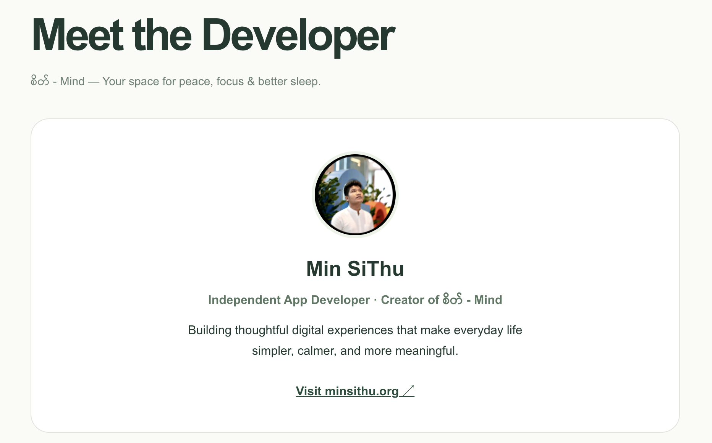
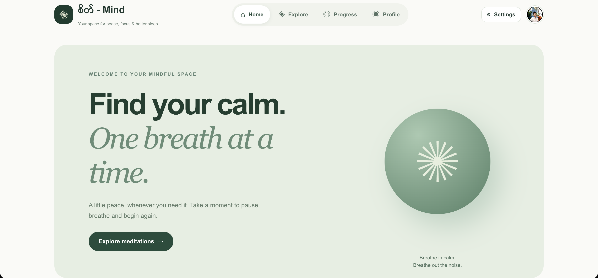
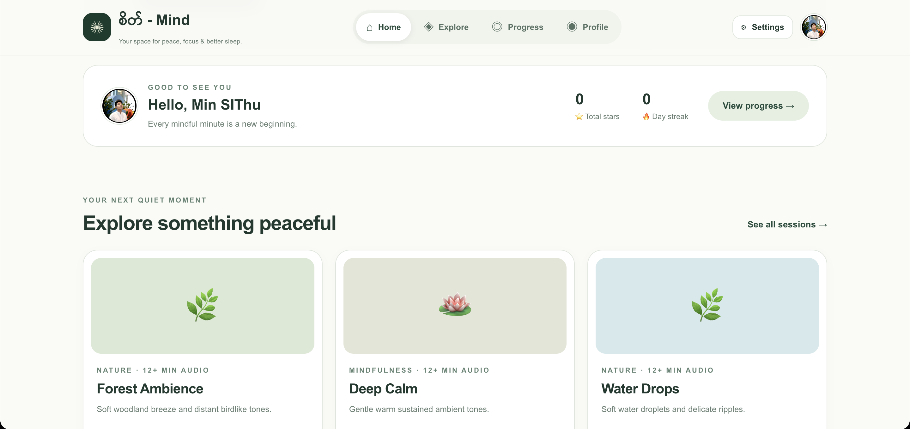
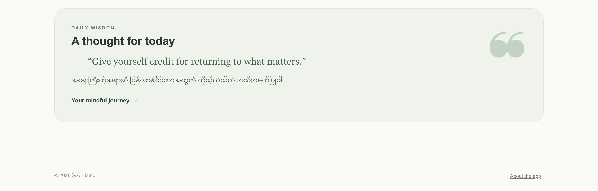
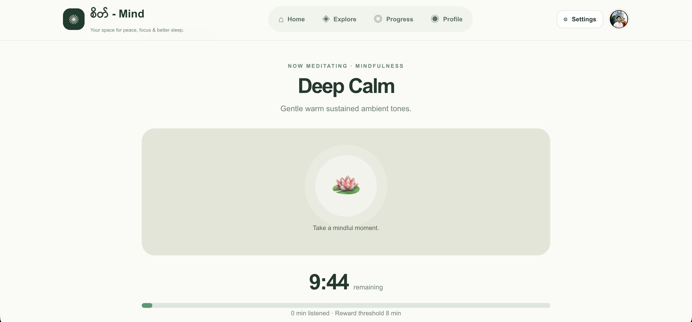
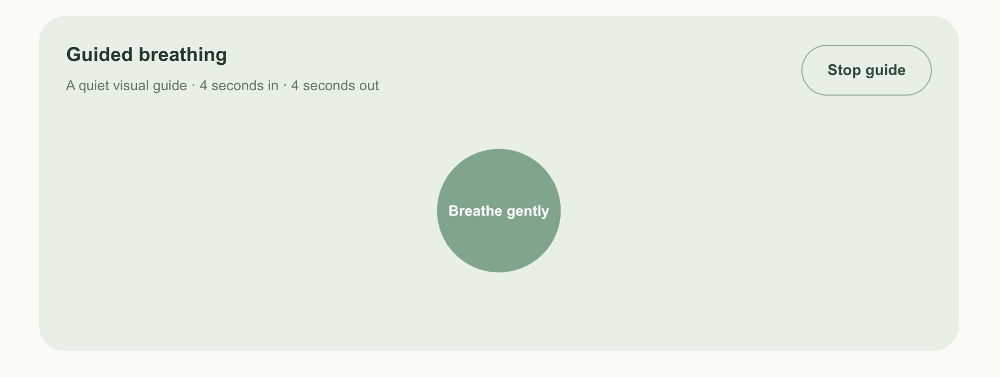
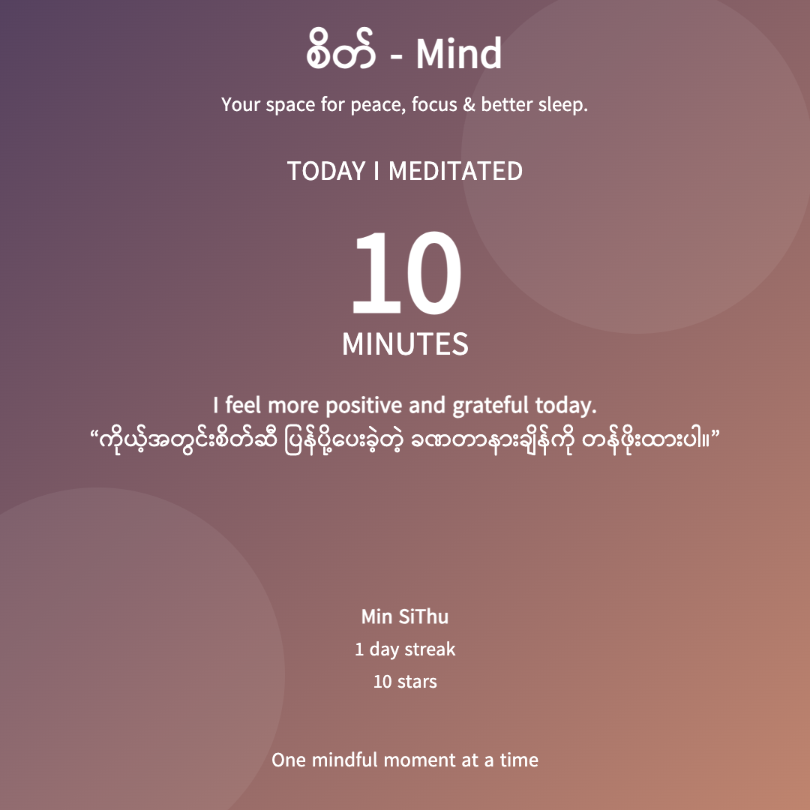
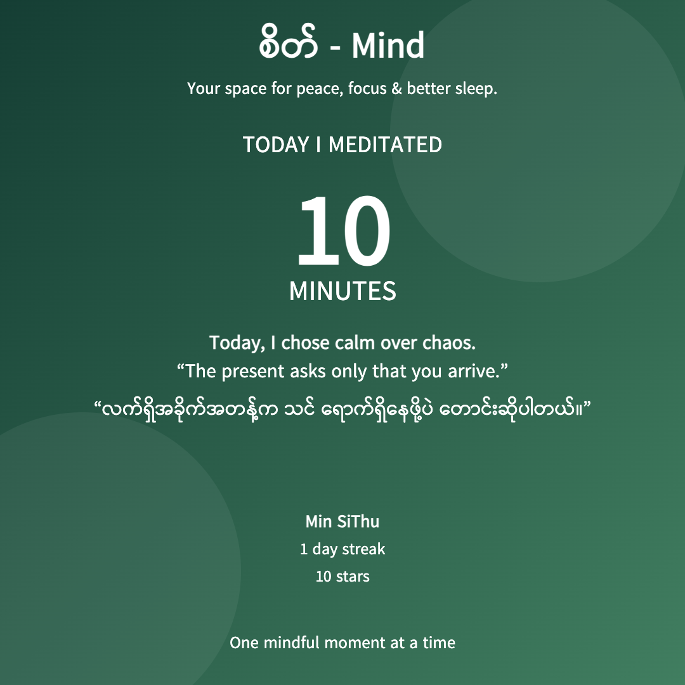

# စိတ် - Mind · v0.8

**Your space for peace, focus & better sleep.**

Developer: **Min SiThu** · https://minsithu.org

**Status: UI Redesign / Beta Source. Not yet approved for public production release.**

## Preview

Live view (no Codespaces): https://itsmeminsithu.github.io/Seit---Mind/










## What changed in 0.8

Earlier versions put the profile form, reminders, meditation library, player, rewards and developer info on one long page. In 0.8 each of those has its own screen, on Android and on Web:

| Screen | What users see |
|---|---|
| Home | Welcome, quick summary, featured meditations and daily bilingual quote |
| Explore | Category filters and meditation audio catalog |
| Player | Chosen meditation, 10/20/30/custom timer, audio playback, breathing, fade-out |
| Progress | Stars, day streak, encouraging guidance and daily wisdom |
| Profile | User avatar, name, simple stats, links to settings and About |
| Settings | **Only after tapping Settings**: Edit Profile, Daily Reminder, Share Privacy, Data Controls |
| About | Original developer photo + name + website; no GitHub repository displayed |
| Completion | Mood, quote, stars, share/save square/story PNG |

Navigation adapts: desktop header, mobile bottom tabs. Android uses Compose NavigationBar. The user's own photo stays in the **About** section only. It is never shown on the Share Card.

## Run it on a Mac (Docker)

The default host port is **3100**, so it does not clash with your other app at 3000.

If v0.7 is already running on port 3100, open a Terminal:

```sh
cd ~/Downloads/Seit-Mind-v0.7
docker compose down
```

Extract the new ZIP to Downloads, then:

```sh
cd ~/Downloads/Seit-Mind-v0.8
docker compose up --build
```

Open **http://localhost:3100**. Inside Docker, Next.js still listens on port 3000. FastAPI listens on container port 8000; the browser reaches it through the same-origin `/api` proxy. Do not change the right-hand side of `"3100:3000"`.

Rebuilding or moving project folders will **not** erase browser localStorage on the same `http://localhost:3100` origin. To inspect containers from another Terminal run `docker compose ps`.

## Run it without Docker

```sh
# Terminal 1, from backend/
python3 -m venv .venv
source .venv/bin/activate
pip install -r requirements.txt
uvicorn main:app --host 0.0.0.0 --port 8000
```

```sh
# Terminal 2, from web/
cp .env.example .env.local
npm install
npm run dev -- -p 3100
```

## Android

Open `android/` in Android Studio. You need Android SDK 35 and JDK 17. This is a native Kotlin + Jetpack Compose project, and it still needs a real Gradle build check. The backend default is the emulator address `http://10.0.2.2:8000`. On a physical Android phone, set `mindApiBaseUrl` in `android/gradle.properties` to your computer's LAN API address, or to a public HTTPS API. The Player, Settings and Completed screens are separate; the background service lifecycle is in `MeditationService.kt`.

## What is in it

- 12 synthesized demo MP3s, each > 12 minutes; 10/20/30 or custom 1–180-minute duration.
- At least 80% of a track has to play to earn stars; 60 stars maximum per day; local streaks, supportive messaging.
- Guided breathing, optional 30-second audio fade, Android foreground playback service.
- 100 original English/Myanmar quotes; mood-based after meditation.
- Square 1080×1080 or Story 1080×1920 PNG export/share; four themes, optional privacy fields.
- Local user profile and photo, daily reminders (web notifications require browser/page open), About developer.
- Pyidaungsu Unicode font is bundled by user request; verify font redistribution permissions before public release.

## Tests and limits

```sh
python -m pytest backend/test_api.py tests/ -q
cd web && node --test tests/*.test.mjs
```

The isolated workspace could run Python and Node unit tests and TypeScript JSX parse checks, but could not install dependencies from npm registry or compile Android APK. **Do not claim production readiness until Docker/Android builds and device testing pass**. Cloud profile sync, true web background push and verified font redistribution rights are not yet included. See `docs/RELEASE_CHECKLIST_v0.8.md`.
